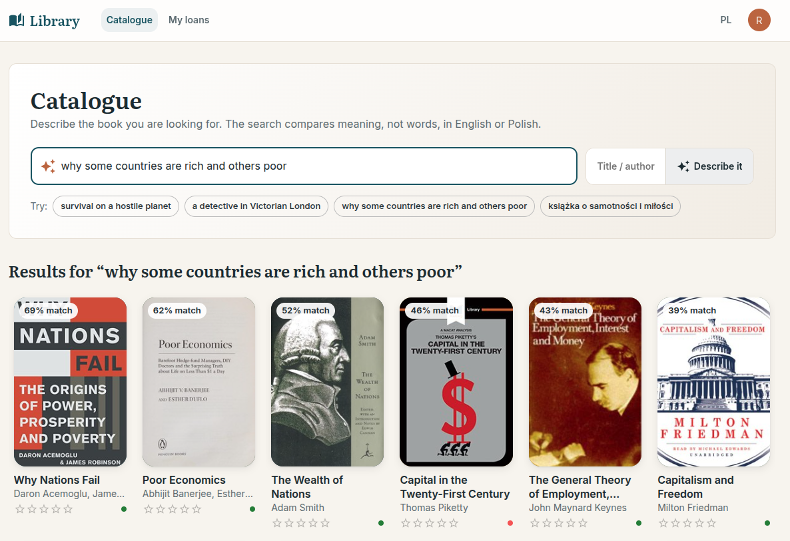
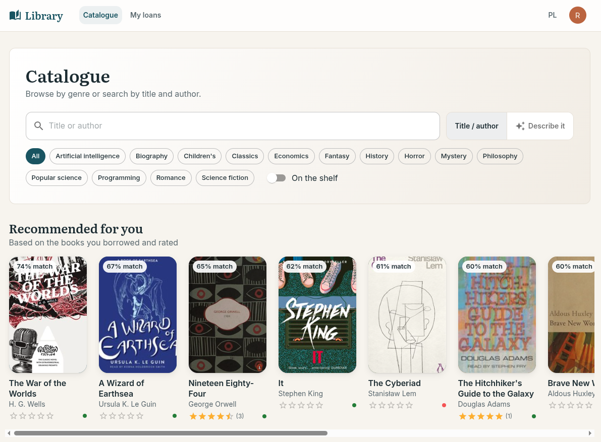
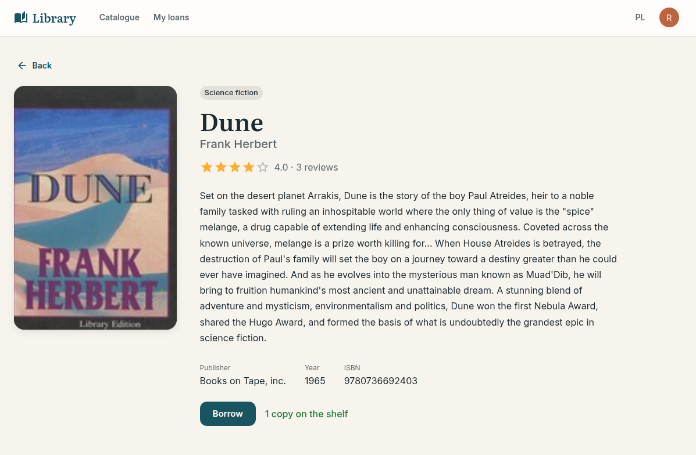
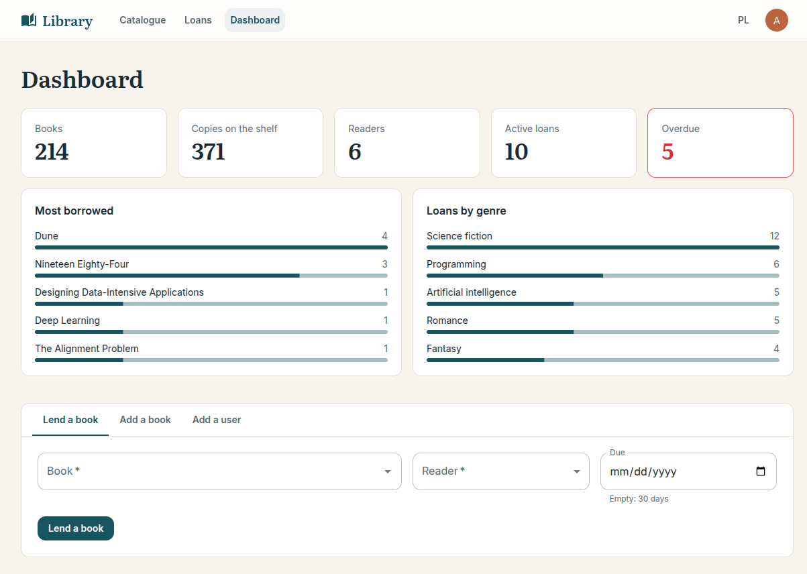
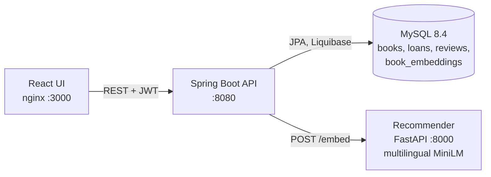

# Library Management System

[](https://github.com/wujciak/library-management-system/actions/workflows/ci.yml)


A library web app with **semantic search**: readers describe the book they want, in English or
Polish, and get the closest matches from a catalogue of 214 books. The core is a Spring Boot REST
API with JWT authentication and role-based access; a small Python service runs a multilingual
sentence-embedding model, and the API uses the vectors for search, "similar books" and
personal recommendations. Librarians manage the catalogue, users, loans and returns.

| Semantic search, in Polish over English descriptions | Recommended for the reader |
| --- | --- |
|  |  |
| **Book page with similar books and reviews** | **Librarian dashboard** |
|  |  |

## Quick start

Requires Docker. The first build downloads PyTorch (CPU) and the embedding model into the
recommender image, so it takes a few minutes.

```bash
docker compose up --build
```

| | URL |
| --- | --- |
| UI | <http://localhost:3000> |
| API docs (Swagger UI) | <http://localhost:8080/swagger-ui.html> |

Demo accounts, created by the database migrations (the login page has buttons for both):

| Username | Password | Role |
| --- | --- | --- |
| `reader` | `reader123` | reader with a science-fiction loan history, so recommendations have something to go on |
| `admin` | `admin123` | librarian: dashboard, catalogue, users, lending and returns |

Five more readers (`anna`, `tom`, `maria`, `piotr`, `kate`, all with `reader123`) have loans and
reviews, so the dashboard, ratings and popular books are not empty.

## Architecture



The recommender is a stateless model server with one endpoint: texts in, unit-length 384-d vectors
out. Everything else stays in the API: the vectors are stored in MySQL next to the books, and
ranking, filtering and access rules are Java code that the integration tests cover.

## Semantic search and recommendations

- **Embedding the catalogue.** Each book is embedded from its title, author, genre and
  description with
  [`paraphrase-multilingual-MiniLM-L12-v2`](https://huggingface.co/sentence-transformers/paraphrase-multilingual-MiniLM-L12-v2),
  which maps 50+ languages into one vector space. A changed book is embedded right after its
  transaction commits; a periodic pass embeds whatever the recommender could not handle at that
  moment, such as the whole catalogue on the first start or every book after a model change.
- **Search** (`GET /api/books/search?q=`) embeds the query and ranks books by cosine similarity.
- **Similar books** (`GET /api/books/{id}/similar`) are the nearest neighbours of a book's vector.
  They need no call to the recommender.
- **Recommendations** (`GET /api/books/recommended`) are content-based: the mean vector of the
  books a reader borrowed or rated 4–5, minus books they already know. A reader with no history
  gets the most borrowed books instead, and the response says which of the two it is.
- **Without the recommender**, the rest of the app keeps working: search returns `503` with a
  problem detail, and similar books and recommendations use the stored vectors.

The vectors are held in memory and ranked by a brute-force dot product, which takes well under a
millisecond for a few thousand books. A vector database would pay off only for a far larger
catalogue.

**How well does it work?** [`scripts/evaluate_search.py`](scripts/evaluate_search.py) runs 21
hand-written queries against the API. Each query describes one book in other words than its
description, 12 in English and 9 in Polish. A TF-IDF keyword search over the same texts serves as
the baseline:

| | hit@1 | hit@5 | MRR@10 |
| --- | --: | --: | --: |
| semantic search, English queries | 0.67 | **1.00** | 0.78 |
| semantic search, Polish queries | 0.78 | **0.78** | 0.78 |
| TF-IDF keywords, English queries | 0.58 | 0.58 | 0.62 |
| TF-IDF keywords, Polish queries | 0.11 | 0.11 | 0.11 |

Keyword search finds a book only when the query shares words with its description, so it fails
on almost every Polish query. This is a small sanity check rather than a benchmark: the queries
were written by me, knowing the catalogue.

## API

All endpoints except login, health and docs need `Authorization: Bearer <token>`. Errors are
returned as [RFC 9457](https://www.rfc-editor.org/rfc/rfc9457) problem details, with per-field
messages for validation errors.

| Method | Path | Who | |
| --- | --- | --- | --- |
| `POST` | `/api/auth/login` | anyone | returns a JWT (1 h) |
| `GET` | `/api/books?q=&genre=&available=&page=&size=` | signed in | paged catalogue: text in title or author, genre, only books on the shelf; with review statistics |
| `GET` | `/api/books/genres` | signed in | |
| `GET` | `/api/books/{id}` | signed in | |
| `POST` `PUT` `DELETE` | `/api/books`, `/api/books/{id}` | admin | `409` for a duplicate ISBN or deleting a book with loans |
| `GET` | `/api/books/search?q=&limit=` | signed in | semantic search; `503` if the recommender is down |
| `GET` | `/api/books/{id}/similar` | signed in | nearest books by description |
| `GET` | `/api/books/recommended` | signed in | for the current reader, `basis` is `HISTORY` or `POPULAR` |
| `GET` | `/api/loans` | signed in | admins see all loans, readers their own |
| `POST` | `/api/loans` | signed in | borrow `{bookId, userId?, dueOn?}`; readers borrow only for themselves; `409` if no copy is left or the book is already on loan to that user |
| `POST` | `/api/loans/{id}/return` | admin | record a return, the copy goes back on the shelf |
| `GET` `POST` | `/api/books/{id}/reviews` | signed in | one review per user and book, score 1–5 |
| `DELETE` | `/api/reviews/{id}` | author or admin | |
| `GET` | `/api/stats` | admin | dashboard: stock, readers, active and overdue loans, most borrowed, loans by genre |
| `GET` | `/api/users/me` | signed in | |
| `GET` `POST` `DELETE` | `/api/users`, `/api/users/{id}` | admin | |

## Design

```text
backend/src/main/java/com/jwojciak/library/
  auth/      login, JWT issue and verification, security configuration
  book/      catalogue: paging, filters, review statistics
  loan/      borrowing and returns
  review/    reviews
  user/      users and roles
  search/    vectors, sync with the recommender, semantic search, similar books, recommendations
  stats/     dashboard numbers
  common/    error handling, paging, OpenAPI, clock
backend/src/main/resources/db/changelog/   Liquibase: schema, catalogue and demo activity
recommender/                               Python embedding service (FastAPI, sentence-transformers)
frontend/src/                              React UI (Vite, MUI, i18next): pages/ and components/
scripts/                                   catalogue builder and search evaluation
```

Each feature package holds its entity, repository, service, controller and request/response
records, so a feature can be read top to bottom in one folder.

- **Authorisation.** URL rules only separate public from authenticated endpoints. Which role may
  do what is declared on each endpoint with `@PreAuthorize`, and ownership rules (a reader's own
  loans and reviews) are checked in the services.
- **Stateless JWT.** No sessions or cookies, so CSRF protection is off by design. The signing key
  comes from `JWT_SECRET`. Login returns the same `401` for an unknown user and a wrong password,
  so usernames cannot be probed.
- **Consistent copy counts.** Borrowing and returning lock the book row (`SELECT … FOR UPDATE`),
  so two readers cannot take the last copy at the same time.
- **Schema under version control.** Liquibase owns the schema and Hibernate only validates it
  (`ddl-auto: validate`). Check constraints guard copy counts and review scores in the database
  as well. Later features arrive as new changesets, never as edits to applied ones.
- **Features stay decoupled.** The book feature publishes a `BookSaved` event and does not know
  about search; review statistics for a page of books come from one aggregate query rather than
  one query per book.
- **The frontend** is a thin client for the demo. I wrote it with a lot of help from AI tools; the
  backend and the recommender are the parts I designed in detail.

## Demo data

The catalogue is built by [`scripts/fetch_catalogue.py`](scripts/fetch_catalogue.py) from a
hand-picked list in [`scripts/catalogue.csv`](scripts/catalogue.csv) (title, author, year, genre).
[Open Library](https://openlibrary.org/developers/api) (CC0) supplies an English edition with its
ISBN, publisher and cover, plus the description of the work; where Open Library has no English
description, the CSV provides a short one. The output is a committed Liquibase changeset, so the
app does not call Open Library at runtime, except for the cover images.

## Tests

- **Backend:** 26 integration tests run the whole application against a real MySQL in Docker
  ([Testcontainers](https://testcontainers.com/)) through the HTTP layer: authentication, role
  checks, validation errors, borrowing and returning, conflicts and ownership, paging and
  filters, search ranking, recommendations, the fallback when the recommender is down, and the
  dashboard. The recommender is replaced by a bag-of-words fake, so ranking logic is tested
  without the model. Each test runs in a rolled-back transaction on top of the demo data.
- **Recommender:** pytest checks the API contract with a fake model: one unit vector per text and
  validation of empty or oversized input.

```bash
cd backend && ./mvnw verify          # needs Docker
cd recommender && uv run pytest
```

CI runs both test suites, ruff and the frontend build on every push.

## Local development

```bash
docker compose up db recommender                     # MySQL on :3306, recommender on :8000
cd backend && ./mvnw spring-boot:run                 # API on :8080
cd frontend && npm ci && npm run dev                 # UI on :3000
python3 scripts/evaluate_search.py                   # search quality, with the stack running
```

The backend reads its configuration from the environment: `MYSQL_HOST`, `MYSQL_PORT`,
`MYSQL_DATABASE`, `MYSQL_USER`, `MYSQL_PASSWORD`, `JWT_SECRET` (Base64, at least 256 bits),
`JWT_EXPIRATION` (ISO-8601 duration, default `PT1H`), `CORS_ALLOWED_ORIGINS` and
`RECOMMENDER_URL` (default `http://localhost:8000`). The frontend reads `VITE_API_URL`.

## History

My first Spring Boot project, written in 2025 for a university course on network technologies.
In 2026 I reworked it: package-by-feature structure, REST resource naming, Liquibase, fixed
authorisation and loan logic, Testcontainers tests, Docker Compose and CI. An unfinished split
into microservices was dropped: for one database and a handful of entities it only added moving
parts. Then I added the part that connects it to my machine learning work: the embedding service,
semantic search and recommendations, a real catalogue, a dashboard, and a new frontend on Vite.
The recommender is a separate service for a concrete reason: it runs a different stack (Python
and PyTorch) and has different resource needs from the API.

## License

[MIT](LICENSE). Catalogue data from Open Library (CC0); covers are loaded from Open Library's
cover service.
