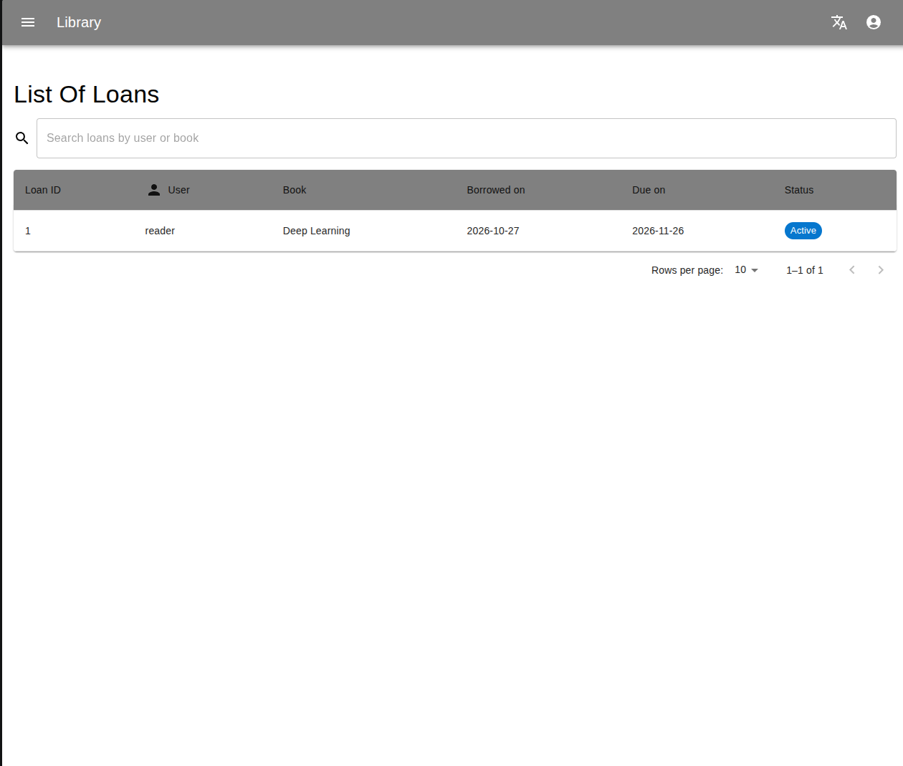
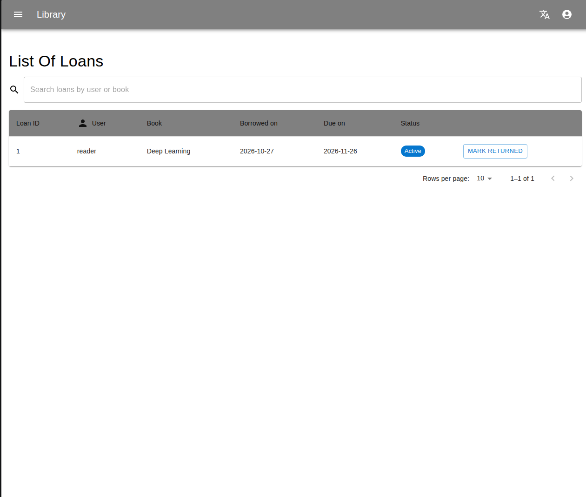

# Library Management System

[](https://github.com/wujciak/library-management-system/actions/workflows/ci.yml)


A library web app: a Spring Boot REST API with JWT authentication and role-based access, and a
React + TypeScript UI in English and Polish. Readers browse the catalogue and borrow books;
librarians (admins) manage books and users, lend books and record returns.

| Reader: own loans only | Admin: all loans, can record returns |
| --- | --- |
|  |  |

## Quick start

Requires Docker.

```bash
docker compose up --build
```

| | URL |
| --- | --- |
| UI | <http://localhost:3000> |
| API docs (Swagger UI) | <http://localhost:8080/swagger-ui.html> |

Demo accounts, created by the database migrations:

| Username | Password | Role |
| --- | --- | --- |
| `admin` | `admin123` | librarian: catalogue, users, lending and returns |
| `reader` | `reader123` | reader: browse and borrow, sees only their own loans |

## API

All endpoints except login, health and docs need `Authorization: Bearer <token>`. Errors are
returned as [RFC 9457](https://www.rfc-editor.org/rfc/rfc9457) problem details, with per-field
messages for validation errors.

| Method | Path | Who | |
| --- | --- | --- | --- |
| `POST` | `/api/auth/login` | anyone | returns a JWT (1 h) |
| `GET` | `/api/books?title=` | signed in | list or search by title |
| `GET` | `/api/books/{id}` | signed in | |
| `POST` `PUT` `DELETE` | `/api/books`, `/api/books/{id}` | admin | `409` for a duplicate ISBN or deleting a book with loans |
| `GET` | `/api/loans` | signed in | admins see all loans, readers their own |
| `POST` | `/api/loans` | signed in | borrow `{bookId, userId?, dueOn?}`; readers borrow only for themselves; `409` if no copy is left or the book is already on loan to that user |
| `POST` | `/api/loans/{id}/return` | admin | record a return, the copy goes back on the shelf |
| `GET` `POST` | `/api/books/{id}/reviews` | signed in | one review per user and book, score 1–5 |
| `DELETE` | `/api/reviews/{id}` | author or admin | |
| `GET` | `/api/users/me` | signed in | |
| `GET` `POST` `DELETE` | `/api/users`, `/api/users/{id}` | admin | |

## Design

```text
backend/src/main/java/com/jwojciak/library/
  auth/      login, JWT issue and verification, security configuration
  book/      catalogue
  loan/      borrowing and returns
  review/    reviews
  user/      users and roles
  common/    error handling, OpenAPI, clock
backend/src/main/resources/db/changelog/   Liquibase: schema and demo data
frontend/src/                               React UI (MUI, Formik, i18next)
```

Each feature package holds its entity, repository, service, controller and request/response
records, so a feature can be read top to bottom in one folder.

- **Authorisation.** URL rules only separate public from authenticated endpoints. Which role may
  do what is declared on each endpoint with `@PreAuthorize`, and ownership rules (a reader's own
  loans and reviews) are checked in the services.
- **Stateless JWT.** No sessions or cookies, so CSRF protection is off by design. The signing key
  comes from `JWT_SECRET`. Login returns the same `401` for an unknown user and a wrong password,
  so usernames cannot be probed.
- **Consistent copy counts.** Borrowing and returning lock the book row (`SELECT … FOR UPDATE`),
  so two readers cannot take the last copy at the same time.
- **Schema under version control.** Liquibase owns the schema and Hibernate only validates it
  (`ddl-auto: validate`). Check constraints guard copy counts and review scores in the database
  as well.

## Tests

19 integration tests run the whole application against a real MySQL in Docker
([Testcontainers](https://testcontainers.com/)) through the HTTP layer: authentication, role
checks, validation errors, borrowing and returning, conflicts and ownership. Each test runs in a
rolled-back transaction on top of the demo data.

```bash
cd backend
./mvnw verify          # needs Docker
```

CI runs the backend tests and the frontend build on every push.

## Local development

```bash
docker compose up db                      # MySQL only
cd backend && ./mvnw spring-boot:run      # API on :8080
cd frontend && npm ci && npm start        # UI on :3000
```

Configuration is read from the environment: `MYSQL_HOST`, `MYSQL_PORT`, `MYSQL_DATABASE`,
`MYSQL_USER`, `MYSQL_PASSWORD`, `JWT_SECRET` (Base64, at least 256 bits), `JWT_EXPIRATION`
(ISO-8601 duration, default `PT1H`) and `CORS_ALLOWED_ORIGINS`.

## History

My first Spring Boot project, written in 2025 for a university course on network technologies.
In 2026 I reworked it: package-by-feature structure, REST resource naming, Liquibase, fixed
authorisation and loan logic, Testcontainers tests, Docker Compose and CI. An unfinished split
into microservices was dropped: for one database and a handful of entities it only added moving
parts.

## License

[MIT](LICENSE)
